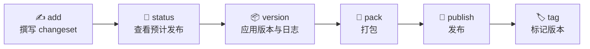
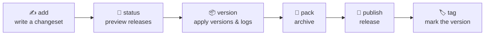

<div align="center">

# 🌙 moonset

**月升则潮起，版本有序，更迭有据。**
*As the moon rises, the tide follows — every release in its proper order.*

为 [MoonBit](https://www.moonbitlang.com) workspace 而生的版本与 Changelog 管理工具
A refined versioning & changelog companion for MoonBit workspaces

<br/>


[中文](#-中文) · [English](#-english) · [文档 Docs](docs/README.md) · [路线图 Roadmap](docs/roadmap.md)

</div>

---

<a id="-中文"></a>

## 🇨🇳 中文

### 缘起

一个优秀的软件包，不仅在于代码精炼，更在于每一次发布皆有迹可循。
**moonset** 取法 [Changesets](https://github.com/changesets/changesets) 的从容之道：让贡献者在提交改动之时，顺手写下一段「变更说明」；待到发布之日，工具自会将这些零散的笔墨，汇成一份清晰的版本计划与一卷整洁的更新日志。

它专为 MoonBit 生态量身打造——理解 `moon.mod` 与 workspace，尊重 Mooncakes 的发布流程，同时支持 npm/pnpm 与 Cargo（crates.io）混合 workspace，并提供零运维的模块化 **GitHub Action PR Bot** 与自动发布流水线。

> [!NOTE]
> **当前状态：Phase 1～5 核心能力与混合 workspace 已实现，PR Bot Action 已纳入主干。**
> 已实现 `init`、`add`、`pre`、`status`（human/json/markdown）、`publish-plan`、`version`、`pack`、`publish`、`tag`、`doctor` 与 `unmbt/moonset/api` 扩展生态；Cargo 支持限定为 `crates.io`，其他 Cargo registry 与 Tauri 同步保持 Deferred。详见 [需求规格](docs/requirements.md) 与 [自动化设计](docs/automation.md)。

### 安装指南

推荐使用 MoonBit 包管理器安装：

```bash
moon install unmbt/moonset/cmd/moonset
moonset -V
```

`moon install` 会将可执行文件安装到 `~/.moon/bin`，请确保该目录已加入 `PATH`。

#### 预编译二进制（普通用户）

如果不希望从源码构建，可使用对应系统的安装脚本下载最新的 GitHub Release（自动校验 `SHA256SUMS`）：

##### Linux & macOS

```bash
curl -fsSL https://raw.githubusercontent.com/unmbt/moonset/master/scripts/install.sh | bash
```

##### Windows (PowerShell)

```powershell
irm https://raw.githubusercontent.com/unmbt/moonset/master/scripts/install.ps1 | iex
```

> **注意**：预编译二进制安装脚本会将文件安装到 `~/.unmbt`（与同组织工具 [moon-bump](https://github.com/unmbt/moon-bump) 共享目录），并自动将其加入 `PATH`。安装完成后可能需要重启终端；CI 环境请直接使用 `unmbt/moonset/setup@v1` Action。

#### AI Agent Skill（指导外部 Agent 使用 `moonset`）

本仓库内置了符合开放 Agent Skills 规范的 [`skills/moonset`](skills/moonset/SKILL.md)，可一键安装到支持 Agent Skills 的编码工具（Antigravity、Claude Code、Cursor、Codex 等）：

```bash
npx skills add unmbt/moonset
```

也可直接将 `skills/moonset/` 目录复制到目标项目的 `.agents/skills/moonset/`。

#### 工具选型：与 `moon-bump` 的分工

- **[moon-bump](https://github.com/unmbt/moon-bump)**：适合单包或紧凑型 workspace 的**本地交互式一键发版**（修改 `moon.mod`、提交、打 tag、推送）。
- **moonset**：适合**PR 协作与多包 / 混合生态（MoonBit + npm/pnpm + Cargo）发版治理**，通过 `.changeset/*.md` 记录变更意图、生成发布计划与 `CHANGELOG.md`，并配合模块化 GitHub Actions 自动化检查与发布。

### 快速上手（本地完整流程）

```bash
# 1. 初始化 .changeset/ 目录、默认配置与 .gitignore
moonset init

# 2. 检查本机工具链、Git 与 workspace 状态
moonset doctor

# 3. 记录一次变更（不传参数进入交互式 TUI，也可使用非交互参数）
moonset add
moonset add --package unmbt/example/core --type minor --summary "新增流式解析接口"

# 4. 预览待发布版本计划（只读）
moonset status --verbose
moonset publish-plan --pretty

# 5. 应用版本号、更新依赖范围并生成 CHANGELOG.md 与 .moonset/release-state.json
moonset version --dry-run
moonset version

# 6. 提交发布改动后，先预演发布再正式发布与打 tag
git add -A && git commit -m "chore: release"
moonset publish --dry-run
moonset publish --yes   # 干净工作树下会自动触发 tag（可用 --no-tag 跳过后手动打标）
moonset tag --push --yes
```

> **预发布模式提示**：可通过 `moonset pre enter alpha --initial-version` 进入预发布，多次发布后执行 `moonset pre exit && moonset version` 毕业为正式版。`--since main` 只读取 `HEAD` 已提交快照，适合 CI 校验 PR 是否附带了 changeset。更多问题见 [常见问题与排障 FAQ](docs/faq.md)。

### 理念

| | 原则 | 释义 |
|:-:|---|---|
| 🪶 | **变更即文稿** | 每一次改动，伴随一份 Markdown changeset，意图与影响一目了然。 |
| 🧮 | **规划器至纯** | 版本推演是不触碰文件、Git 与网络的纯计算，便于测试，亦便于信任。 |
| 🔌 | **适配器可换** | Git、Mooncakes、GitHub 等副作用皆收束于适配器，核心不作任何平台假设。 |
| 🛡️ | **写盘有度** | 先校验、后落笔；任何一步失败，皆不留下半成品。文件原子替换，失败可恢复。 |
| 🧾 | **输出皆契约** | 人类输出与 `--json` 同为接口，脚本只需依赖版本化的 JSON。 |

### 工作流程



### 命令一览（设计契约）

| 命令 | 作用 | 默认写盘 | 网络 |
|---|---|:-:|:-:|
| `init` | 初始化 `.changeset` 目录 | ✅ | — |
| `add` | 创建一份 changeset | ✅ | — |
| `status` | 查看变化与预计发布 | — | — |
| `publish-plan` | 输出完整 release plan（JSON） | — | — |
| `version` | 应用版本号并生成 changelog | ✅ | — |
| `pre` | 进入、退出或查看预发布模式 | ✅ | — |
| `pack` | 生成 MoonBit 包归档 | 可选 | — |
| `publish` | 发布已版本化的模块 | 可选 | ✅ |
| `tag` | 创建当前版本的 Git 标签 | 可选 | 可选 |
| `doctor` | 只读诊断本机与 workspace | — | 可选 |

完整参数、输出与退出码见 [命令契约](docs/commands.md)。

### 一瞥

**Changeset** 是一份朴素的 Markdown，以 front matter 标明受影响的模块与版本级别：

```markdown
---
"unmbt/example/core": minor
"unmbt/example/cli": patch
---

新增流式解析接口；CLI 随之修正了换行处理。
```

**配置** 位于 `.changeset/config.json`，开箱即有合理的默认值：

```json
{
  "schemaVersion": 1,
  "baseBranch": "main",
  "access": "public",
  "fixed": [["unmbt/core", "unmbt/cli"]],
  "updateInternalDependencies": "patch",
  "changelog": { "generator": "github", "options": { "repo": "unmbt/moonset" } },
  "publisher": { "kind": "moon", "registry": "default", "dryRunFirst": true }
}
```

更多字段详见 [配置规范](docs/configuration.md) 与 [JSON Schema](docs/schema/config-v1.json)。

### PR Bot 快速接入（GitHub Action）

无需注册或托管 GitHub App；复制下方工作流到 `.github/workflows/moonset-pr-bot.yml` 即可在 1 分钟内启用 PR 检查与自动评论更新（采用双 Job 隔离权限，安全支持 Fork PR）：

```yaml
name: moonset bot
on:
  pull_request_target:
    types: [opened, synchronize, reopened, ready_for_review]
concurrency:
  group: moonset-pr-bot-${{ github.event.pull_request.number }}
  cancel-in-progress: true
permissions: {}
jobs:
  check:
    runs-on: ubuntu-latest
    permissions: { contents: read }
    outputs:
      comment: ${{ steps.check.outputs.comment }}
      state: ${{ steps.check.outputs.state }}
      should-comment: ${{ steps.check.outputs.should-comment }}
    steps:
      - uses: actions/checkout@v5
        with:
          ref: ${{ github.event.pull_request.head.sha }}
          fetch-depth: 0
          persist-credentials: false
      - id: check
        uses: unmbt/moonset/pr-check@v1
        with:
          base-sha: ${{ github.event.pull_request.base.sha }}
          head-repo: ${{ github.event.pull_request.head.repo.full_name }}
          head-ref: ${{ github.event.pull_request.head.ref }}
  comment:
    needs: check
    runs-on: ubuntu-latest
    permissions: { pull-requests: write }
    steps:
      - uses: unmbt/moonset/pr-comment@v1
        with:
          comment: ${{ needs.check.outputs.comment }}
          state: ${{ needs.check.outputs.state }}
          should-comment: ${{ needs.check.outputs.should-comment }}
```

### 自动 Release PR 与发布（GitHub Action）

复制到 `.github/workflows/moonset-release.yml`，主分支合入带 changeset 的 PR 后会自动创建/更新 Release PR，合并 Release PR 后自动发布到 Mooncakes 并打 tag：

```yaml
name: moonset release
on:
  push:
    branches: [main]
concurrency:
  group: moonset-release-${{ github.ref }}
  cancel-in-progress: false
permissions: {}
jobs:
  version-pr:
    runs-on: ubuntu-latest
    permissions: { contents: write, pull-requests: write }
    outputs:
      has-changesets: ${{ steps.release.outputs.has-changesets }}
    steps:
      - uses: actions/checkout@v5
        with: { fetch-depth: 0 }
      - id: release
        uses: unmbt/moonset@v1
        with:
          mode: version-pr
  publish:
    needs: version-pr
    if: needs.version-pr.outputs.has-changesets == 'false'
    runs-on: ubuntu-latest
    permissions: { contents: write, id-token: write }
    steps:
      - uses: actions/checkout@v5
        with: { fetch-depth: 0 }
      - uses: hustcer/setup-moonbit@v1
      - uses: unmbt/moonset@v1
        with:
          mode: publish
          mooncakes-credentials: ${{ secrets.MOONCAKES_CREDENTIALS }}
```

> **上线前两项必查**：① 在仓库 **`Settings → Actions → General → Workflow permissions`** 勾选 **`Allow GitHub Actions to create and approve pull requests`**；② 在 **`Settings → Secrets and variables → Actions`** 配置 `MOONCAKES_CREDENTIALS`（与 `~/.moon/credentials.json` 一致）。若默认分支为 `master`，请同步调整 `branches` 与 `.changeset/config.json` 中的 `baseBranch`。详细排障见 [FAQ](docs/faq.md) 与 [自动化设计](docs/automation.md)。

### 架构

```text
moonset/
├─ cmd/moonset/          CLI 入口、退出码与顶层错误
├─ model/                领域类型与序列化 schema（纯核）
├─ engine/               解析、校验、纯规划与 Markdown 评论渲染（纯核）
├─ changelog/            内置 changelog 生成器与 registry（纯核）
├─ workspace/            moon.mod / moon.work / npm / pnpm / Cargo 发现
├─ adapters/             Capability 契约、PublisherRegistry 与 JSONL 插件
├─ executor/             ExecutionHost、原子 journal、staging、pack/publish/tag/doctor
├─ api/                  稳定编程 API facade
├─ cli/                  参数解析、TUI 与输出渲染
├─ setup/ pr-check/ pr-comment/   模块化 PR Bot GitHub Actions
└─ action.yml            根发布 Action（version-pr / publish）
```

异步与进程能力基于 `moonbitlang/core/async`；命令参数与程序名严格分离，绝不把用户输入拼接为 shell 字符串。详见 [系统架构](docs/architecture.md)。

### 路线图

| 阶段 | 主题 | 状态 |
|:-:|---|:-:|
| 0 | 规格与探针 | 已完成 |
| 1 | 核心读模型与规划器（`status` · `publish-plan`） | 已实现 |
| 2 | 贡献工作流（`init` · `add` · `pre`） | 已实现 |
| 3 | 版本与 Changelog（`version` · `tag`） | 已实现 |
| 4 | 发布与官方自动化（`pack` · `publish` · Actions） | 已实现（含发布 Action） |
| 5 | 扩展生态（稳定 API 与插件协议） | 已实现 |
| 6 | PR Bot Actions 与规模化治理 | PR Bot Action 与 100 包基准已发布 `v0.1.0`（1000 包 / `FR-022` 矩阵见 `0.2.0+`） |

每个阶段皆有明确的退出条件，详见 [Roadmap](docs/roadmap.md)。

### 文档索引

[常见问题 FAQ](docs/faq.md) · [需求规格](docs/requirements.md) · [命令契约](docs/commands.md) · [配置规范](docs/configuration.md) · [数据模型](docs/data-model.md) · [系统架构](docs/architecture.md) · [Changelog 规范](docs/changelog.md) · [自动化设计](docs/automation.md) · [编程 API](docs/api.md) · [测试策略](docs/test-strategy.md) · [参考实现评估](docs/references.md) · [设计决策](docs/decisions/README.md)

### 参与开发

```bash
moon check      # 类型检查
moon test       # 运行测试
moon info && moon fmt   # 更新接口并格式化
```

欢迎以 Issue 与 Pull Request 参与共建。提交前请阅读 [docs/README.md](docs/README.md) 中的 SDD 工作规则：**先有契约，后有代码**。

### 许可

以 [MIT](LICENSE) 授权。

<div align="right"><a href="#-moonset">↑ 回到顶部</a></div>

---

<a id="-english"></a>

## 🇬🇧 English

### Genesis

A fine package is measured not only by the elegance of its code, but by the clarity of its every release.
**moonset** takes its quiet philosophy from [Changesets](https://github.com/changesets/changesets): while contributing, you leave a short note describing your change; when release day arrives, those scattered notes are gathered into a precise version plan and a tidy changelog.

Crafted for the MoonBit ecosystem, it understands `moon.mod` and workspaces, respects the Mooncakes publishing flow, supports mixed npm/pnpm & Cargo (crates.io) workspaces, and provides zero-ops modular **GitHub Actions** for PR checks, comments, and releases.

> [!NOTE]
> **Current status: Phases 1–5 core & mixed workspaces implemented; PR Bot GitHub Actions integrated.**
> `init`, `add`, `pre`, `status` (human/json/markdown), `publish-plan`, `version`, `pack`, `publish`, `tag`, `doctor`, and `unmbt/moonset/api` are implemented. Cargo support is limited to `crates.io`, and Tauri/other registries remain deferred. See [Requirements](docs/requirements.md) and [Automation](docs/automation.md).

### Installation

The recommended installation method is the MoonBit package manager:

```bash
moon install unmbt/moonset/cmd/moonset
moonset -V
```

`moon install` places the executable in `~/.moon/bin`. Make sure that directory is included in your `PATH`.

#### Pre-compiled Binary

If you prefer not to build from source, use the installation script for your OS to download and SHA-256 verify the latest GitHub Release:

##### Linux & macOS

```bash
curl -fsSL https://raw.githubusercontent.com/unmbt/moonset/master/scripts/install.sh | bash
```

##### Windows (PowerShell)

```powershell
irm https://raw.githubusercontent.com/unmbt/moonset/master/scripts/install.ps1 | iex
```

> **Note**: The user install scripts place `moonset` into `~/.unmbt` (alongside [moon-bump](https://github.com/unmbt/moon-bump)) and add it to your `PATH`. Restart your terminal if needed. For CI workflows, use the dedicated `unmbt/moonset/setup@v1` GitHub Action instead.

#### AI Agent Skill

This repository ships an Agent Skill at [`skills/moonset`](skills/moonset/SKILL.md) so AI coding agents (Antigravity, Claude Code, Cursor, Codex, etc.) can use `moonset` non-interactively and safely:

```bash
npx skills add unmbt/moonset
```

Alternatively, copy `skills/moonset/` into `.agents/skills/moonset/` in your target workspace.

#### Choosing between `moonset` and `moon-bump`

- **[moon-bump](https://github.com/unmbt/moon-bump)**: streamlined interactive version bumping for single modules or lockstep MoonBit workspaces.
- **moonset**: PR-centric changeset workflow, release planning, changelog generation, and multi-ecosystem (`MoonBit` + `npm/pnpm` + `Cargo`) automation with modular GitHub Actions.

### Quick Start (CLI Workflow)

```bash
# 1. Initialise .changeset/ config, README, and .gitignore
moonset init

# 2. Verify local MoonBit, Git, and workspace configuration
moonset doctor

# 3. Create a changeset (interactive TUI by default, or pass flags)
moonset add
moonset add --package unmbt/example/core --type minor --summary "Add streaming parser"

# 4. Preview pending releases (read-only)
moonset status --verbose
moonset publish-plan --pretty

# 5. Apply version bumps, dependency ranges, CHANGELOG.md, and release-state.json
moonset version --dry-run
moonset version

# 6. Commit release changes, preflight, publish, and push tags
git add -A && git commit -m "chore: release"
moonset publish --dry-run
moonset publish --yes
moonset tag --push --yes
```

> **Prereleases**: run `moonset pre enter alpha --initial-version` to enter prerelease mode, then graduate back to stable with `moonset pre exit && moonset version`. See [FAQ & Troubleshooting](docs/faq.md) for common questions.

### Philosophy

| | Principle | In essence |
|:-:|---|---|
| 🪶 | **Changes as prose** | Every change travels with a Markdown changeset, so intent and impact are plain to see. |
| 🧮 | **A pure planner** | Version planning is pure computation — no files, Git or network — easy to test, easy to trust. |
| 🔌 | **Swappable adapters** | Git, Mooncakes and GitHub live behind adapters; the core assumes no platform. |
| 🛡️ | **Measured writes** | Validate first, write later. Files are replaced atomically, and failures leave nothing half-done. |
| 🧾 | **Output is contract** | Human output and `--json` are both interfaces; scripts rely on versioned JSON alone. |

### Workflow



### Commands (design contract)

| Command | Purpose | Writes by default | Network |
|---|---|:-:|:-:|
| `init` | Initialise the `.changeset` directory | ✅ | — |
| `add` | Create a changeset | ✅ | — |
| `status` | Inspect changes and the expected release | — | — |
| `publish-plan` | Emit the full release plan (JSON) | — | — |
| `version` | Apply versions and generate the changelog | ✅ | — |
| `pre` | Enter, exit or inspect pre-release mode | ✅ | — |
| `pack` | Produce MoonBit package archives | optional | — |
| `publish` | Publish versioned modules | optional | ✅ |
| `tag` | Create Git tags for the current version | optional | optional |
| `doctor` | Read-only diagnosis of host and workspace | — | optional |

Flags, output and exit codes are specified in the [command contract](docs/commands.md).

### A Glimpse

A **changeset** is a modest Markdown file whose front matter names the affected modules and bump levels:

```markdown
---
"unmbt/example/core": minor
"unmbt/example/cli": patch
---

Add a streaming parser API; the CLI now handles line endings correctly.
```

**Configuration** lives in `.changeset/config.json`, with sensible defaults out of the box:

```json
{
  "schemaVersion": 1,
  "baseBranch": "main",
  "access": "public",
  "fixed": [["unmbt/core", "unmbt/cli"]],
  "updateInternalDependencies": "patch",
  "changelog": { "generator": "github", "options": { "repo": "unmbt/moonset" } },
  "publisher": { "kind": "moon", "registry": "default", "dryRunFirst": true }
}
```

See the [configuration spec](docs/configuration.md) and the [JSON Schema](docs/schema/config-v1.json) for every field.

### GitHub Actions Integration (PR Bot & Releases)

Add the ready-to-use workflows from [docs/examples/workflows/](docs/examples/workflows/):

- **PR Bot** ([moonset-pr-bot.yml](docs/examples/workflows/moonset-pr-bot.yml)): two-job `pull_request_target` check (`unmbt/moonset/pr-check@v1`) and idempotent PR comment updater (`unmbt/moonset/pr-comment@v1`), safe for external Fork PRs.
- **Automated Release PR & Publish** ([moonset-release.yml](docs/examples/workflows/moonset-release.yml)): opens/updates the release PR on `push` (`mode: version-pr`), then publishes to `mooncakes.io` and pushes tags upon merge (`mode: publish`).

> [!IMPORTANT]
> Before enabling automated Release PRs:
> 1. Enable **`Allow GitHub Actions to create and approve pull requests`** under **`Settings → Actions → General → Workflow permissions`**.
> 2. Add repository secret **`MOONCAKES_CREDENTIALS`** (contents of `~/.moon/credentials.json` after `moon login`).
> See [FAQ & Troubleshooting](docs/faq.md) if you hit permission or runner queuing issues.

### Architecture

```text
moonset/
├─ cmd/moonset/          entry point, exit codes, top-level errors
├─ model/                domain types and serialisation schema (pure core)
├─ engine/               parsing, pure release planner, Markdown bot renderer (pure core)
├─ changelog/            built-in generators & registry (pure core)
├─ workspace/            moon.mod / moon.work / npm / pnpm / Cargo discovery
├─ adapters/             capability contracts, PublisherRegistry & JSONL plugins
├─ executor/             ExecutionHost, atomic journal, staging, pack/publish/tag/doctor
├─ api/                  stable public API facade
├─ cli/                  argument parsing, TUI & output rendering
├─ setup/ pr-check/ pr-comment/   modular PR Bot GitHub Actions
└─ action.yml            root release Action (version-pr / publish)
```

Asynchrony and processes build on `moonbitlang/core/async`; program names and arguments are kept strictly apart, and user input is never spliced into a shell string. See the [architecture](docs/architecture.md).

### Roadmap

| Phase | Theme | Status |
|:-:|---|:-:|
| 0 | Specification & probes | Completed |
| 1 | Core read model & planner (`status` · `publish-plan`) | Implemented |
| 2 | Contribution workflow (`init` · `add` · `pre`) | Implemented |
| 3 | Versioning & changelog (`version` · `tag`) | Implemented |
| 4 | Publishing & official automation (`pack` · `publish` · Actions) | Implemented |
| 5 | Extension ecosystem (stable API & plugin protocol) | Implemented |
| 6 | PR Bot Actions & governance at scale | PR Bot Actions & 100-pkg bench shipped in `v0.1.0` (`v0.2.0+` tracks 1000-pkg & `FR-022` matrix) |

Each phase has explicit exit criteria — see the [Roadmap](docs/roadmap.md).

### Documentation

[FAQ](docs/faq.md) · [Requirements](docs/requirements.md) · [Commands](docs/commands.md) · [Configuration](docs/configuration.md) · [Data model](docs/data-model.md) · [Architecture](docs/architecture.md) · [Changelog](docs/changelog.md) · [Automation](docs/automation.md) · [API](docs/api.md) · [Test strategy](docs/test-strategy.md) · [References](docs/references.md) · [Decisions](docs/decisions/README.md)

### Contributing

```bash
moon check      # type-check
moon test       # run the tests
moon info && moon fmt   # refresh interfaces and format
```

Issues and pull requests are warmly welcome. Before contributing, please read the SDD working rules in [docs/README.md](docs/README.md): **contract first, code after**.

### License

Released under the [MIT](LICENSE).

<div align="center">

<br/>

*月落乌啼，版本不乱；潮生潮落，发布有章。*
*Let every tide rise and fall in order.*

<a href="#-moonset">↑ Back to top</a>

</div>
