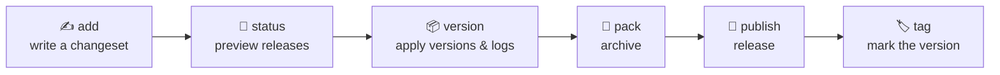

<div align="center">

# 🌙 moonset

**月升则潮起，版本有序，更迭有据。**
*As the moon rises, the tide follows — every release in its proper order.*

为 [MoonBit](https://www.moonbitlang.com) workspace 而生的版本与 Changelog 管理工具
A refined versioning & changelog companion for MoonBit workspaces

<br/>


[中文](#-中文) · [English](#-english) · [文档 Docs](docs/README.md) · [路线图 Roadmap](docs/roadmap.md)

</div>

---

<a id="-中文"></a>

## 🇨🇳 中文

### 缘起

一个优秀的软件包，不仅在于代码精炼，更在于每一次发布皆有迹可循。
**moonset** 取法 [Changesets](https://github.com/changesets/changesets) 的从容之道：让贡献者在提交改动之时，顺手写下一段「变更说明」；待到发布之日，工具自会将这些零散的笔墨，汇成一份清晰的版本计划与一卷整洁的更新日志。

它专为 MoonBit 生态量身打造——理解 `moon.mod` 与 workspace，尊重 Mooncakes 的发布流程，亦为 Git、GitHub Actions 与 GitHub App 预留了优雅的接入之处。

> [!NOTE]
> **当前状态：Phase 1 alpha。**
> 已实现 MoonBit workspace 发现、changeset/config 解析、纯发布规划、`status` 和 `publish-plan`。其余命令仍为后续阶段设计；JS/Cargo adapter 尚未接入。详见 [Phase 1 契约](docs/phase-1-contract.md)。

```sh
moon run cmd/moonset -- status --json
moon run cmd/moonset -- publish-plan --pretty
moon run cmd/moonset -- status --since main --json
```

`publish-plan` 输出不可执行的分析计划；不会改版本或发布。`--since` 使用已提交的 HEAD 快照，空 changeset 可以放行 PR 检查。

### 理念

| | 原则 | 释义 |
|:-:|---|---|
| 🪶 | **变更即文稿** | 每一次改动，伴随一份 Markdown changeset，意图与影响一目了然。 |
| 🧮 | **规划器至纯** | 版本推演是不触碰文件、Git 与网络的纯计算，便于测试，亦便于信任。 |
| 🔌 | **适配器可换** | Git、Mooncakes、GitHub 等副作用皆收束于适配器，核心不作任何平台假设。 |
| 🛡️ | **写盘有度** | 先校验、后落笔；任何一步失败，皆不留下半成品。文件原子替换，失败可恢复。 |
| 🧾 | **输出皆契约** | 人类输出与 `--json` 同为接口，脚本只需依赖版本化的 JSON。 |

### 工作流程


### 命令一览（设计契约）

| 命令 | 作用 | 默认写盘 | 网络 |
|---|---|:-:|:-:|
| `init` | 初始化 `.changeset` 目录 | ✅ | — |
| `add` | 创建一份 changeset | ✅ | — |
| `status` | 查看变化与预计发布 | — | — |
| `publish-plan` | 输出完整 release plan（JSON） | — | — |
| `version` | 应用版本号并生成 changelog | ✅ | — |
| `pre` | 进入、退出或查看预发布模式 | ✅ | — |
| `pack` | 生成 MoonBit 包归档 | 可选 | — |
| `publish` | 发布已版本化的模块 | 可选 | ✅ |
| `tag` | 创建当前版本的 Git 标签 | 可选 | 可选 |
| `doctor` | 只读诊断本机与 workspace | — | 可选 |

完整参数、输出与退出码见 [命令契约](docs/commands.md)。

### 一瞥

**Changeset** 是一份朴素的 Markdown，以 front matter 标明受影响的模块与版本级别：

```markdown
---
"unmbt/example/core": minor
"unmbt/example/cli": patch
---

新增流式解析接口；CLI 随之修正了换行处理。
```

**配置** 位于 `.changeset/config.json`，开箱即有合理的默认值：

```json
{
  "schemaVersion": 1,
  "baseBranch": "main",
  "access": "public",
  "fixed": [["unmbt/core", "unmbt/cli"]],
  "updateInternalDependencies": "patch",
  "changelog": { "generator": "github", "options": { "repo": "unmbt/moonset" } },
  "publisher": { "kind": "moon", "registry": "default", "dryRunFirst": true }
}
```

更多字段详见 [配置规范](docs/configuration.md) 与 [JSON Schema](docs/schema/config-v1.json)。

### 架构

```text
moonset/
├─ cmd/moonset/          入口、退出码与顶层错误
├─ model/                领域类型与序列化 schema
├─ engine/               discover · read · build · apply 的公共 facade
└─ internal/
   ├─ workspace/         moon.mod / moon.work 发现与依赖图
   ├─ changeset/         front matter、摘要与预发布状态
   ├─ config/            默认值、解析、合并与校验
   ├─ planner/           纯 release plan 算法
   ├─ changelog/         内置生成器与格式化
   ├─ git/  publisher/   外部世界的适配器
   └─ atomic/            哈希校验、临时文件与回滚
```

异步与进程能力基于 `moonbitlang/core/async`；命令参数与程序名严格分离，绝不把用户输入拼接为 shell 字符串。详见 [系统架构](docs/architecture.md)。

### 路线图

| 阶段 | 主题 | 状态 |
|:-:|---|:-:|
| 0 | 规格与探针 | 已建立基线 |
| 1 | 核心读模型与规划器（`status` · `publish-plan`） | alpha 已实现 |
| 2 | 贡献工作流（`init` · `add` · `pre`） | ⏳ |
| 3 | 版本与 Changelog（`version` · `tag`） | ⏳ |
| 4 | 发布与官方自动化（`pack` · `publish`） | ⏳ |
| 5 | 扩展生态（稳定 API 与插件协议） | ⏳ |
| 6 | GitHub App 与规模化治理 | ⏳ |

每个阶段皆有明确的退出条件，详见 [Roadmap](docs/roadmap.md)。

### 文档索引

[需求规格](docs/requirements.md) · [命令契约](docs/commands.md) · [配置规范](docs/configuration.md) · [数据模型](docs/data-model.md) · [系统架构](docs/architecture.md) · [Changelog 规范](docs/changelog.md) · [自动化设计](docs/automation.md) · [编程 API](docs/api.md) · [测试策略](docs/test-strategy.md) · [参考实现评估](docs/references.md) · [设计决策](docs/decisions/README.md)

### 参与开发

```bash
moon check      # 类型检查
moon test       # 运行测试
moon info && moon fmt   # 更新接口并格式化
```

欢迎以 Issue 与 Pull Request 参与共建。提交前请阅读 [docs/README.md](docs/README.md) 中的 SDD 工作规则：**先有契约，后有代码**。

### 许可

以 [MIT](LICENSE) 授权。

<div align="right"><a href="#-moonset">↑ 回到顶部</a></div>

---

<a id="-english"></a>

## 🇬🇧 English

### Genesis

A fine package is measured not only by the elegance of its code, but by the clarity of its every release.
**moonset** takes its quiet philosophy from [Changesets](https://github.com/changesets/changesets): while contributing, you leave a short note describing your change; when release day arrives, those scattered notes are gathered into a precise version plan and a tidy changelog.

Crafted for the MoonBit ecosystem, it understands `moon.mod` and workspaces, respects the Mooncakes publishing flow, and leaves graceful extension points for Git, GitHub Actions and GitHub Apps.

> [!NOTE]
> **Current status: Phase 1 alpha.**
> MoonBit workspace discovery, changeset/config parsing, pure release planning, `status`, and `publish-plan` are implemented. Other commands and JS/Cargo adapters remain future contracts. Plans are analysis-only and cannot execute releases.

### Philosophy

| | Principle | In essence |
|:-:|---|---|
| 🪶 | **Changes as prose** | Every change travels with a Markdown changeset, so intent and impact are plain to see. |
| 🧮 | **A pure planner** | Version planning is pure computation — no files, Git or network — easy to test, easy to trust. |
| 🔌 | **Swappable adapters** | Git, Mooncakes and GitHub live behind adapters; the core assumes no platform. |
| 🛡️ | **Measured writes** | Validate first, write later. Files are replaced atomically, and failures leave nothing half-done. |
| 🧾 | **Output is contract** | Human output and `--json` are both interfaces; scripts rely on versioned JSON alone. |

### Workflow



### Commands (design contract)

| Command | Purpose | Writes by default | Network |
|---|---|:-:|:-:|
| `init` | Initialise the `.changeset` directory | ✅ | — |
| `add` | Create a changeset | ✅ | — |
| `status` | Inspect changes and the expected release | — | — |
| `publish-plan` | Emit the full release plan (JSON) | — | — |
| `version` | Apply versions and generate the changelog | ✅ | — |
| `pre` | Enter, exit or inspect pre-release mode | ✅ | — |
| `pack` | Produce MoonBit package archives | optional | — |
| `publish` | Publish versioned modules | optional | ✅ |
| `tag` | Create Git tags for the current version | optional | optional |
| `doctor` | Read-only diagnosis of host and workspace | — | optional |

Flags, output and exit codes are specified in the [command contract](docs/commands.md).

### A Glimpse

A **changeset** is a modest Markdown file whose front matter names the affected modules and bump levels:

```markdown
---
"unmbt/example/core": minor
"unmbt/example/cli": patch
---

Add a streaming parser API; the CLI now handles line endings correctly.
```

**Configuration** lives in `.changeset/config.json`, with sensible defaults out of the box:

```json
{
  "schemaVersion": 1,
  "baseBranch": "main",
  "access": "public",
  "fixed": [["unmbt/core", "unmbt/cli"]],
  "updateInternalDependencies": "patch",
  "changelog": { "generator": "github", "options": { "repo": "unmbt/moonset" } },
  "publisher": { "kind": "moon", "registry": "default", "dryRunFirst": true }
}
```

See the [configuration spec](docs/configuration.md) and the [JSON Schema](docs/schema/config-v1.json) for every field.

### Architecture

```text
moonset/
├─ cmd/moonset/          entry point, exit codes, top-level errors
├─ model/                domain types and serialisation schema
├─ engine/               public facade: discover · read · build · apply
└─ internal/
   ├─ workspace/         moon.mod / moon.work discovery, dependency graph
   ├─ changeset/         front matter, summaries, pre-release state
   ├─ config/            defaults, parsing, merging, validation
   ├─ planner/           the pure release-plan algorithm
   ├─ changelog/         built-in generators and formatting
   ├─ git/  publisher/   adapters to the outside world
   └─ atomic/            hash checks, temp files, rollback
```

Asynchrony and processes build on `moonbitlang/core/async`; program names and arguments are kept strictly apart, and user input is never spliced into a shell string. See the [architecture](docs/architecture.md).

### Roadmap

| Phase | Theme | Status |
|:-:|---|:-:|
| 0 | Specification & probes | 🌗 In progress |
| 1 | Core read model & planner (`status` · `publish-plan`) | alpha implemented |
| 2 | Contribution workflow (`init` · `add` · `pre`) | ⏳ |
| 3 | Versioning & changelog (`version` · `tag`) | ⏳ |
| 4 | Publishing & official automation (`pack` · `publish`) | ⏳ |
| 5 | Extension ecosystem (stable API & plugin protocol) | ⏳ |
| 6 | GitHub App & governance at scale | ⏳ |

Each phase has explicit exit criteria — see the [Roadmap](docs/roadmap.md).

### Documentation

[Requirements](docs/requirements.md) · [Commands](docs/commands.md) · [Configuration](docs/configuration.md) · [Data model](docs/data-model.md) · [Architecture](docs/architecture.md) · [Changelog](docs/changelog.md) · [Automation](docs/automation.md) · [API](docs/api.md) · [Test strategy](docs/test-strategy.md) · [References](docs/references.md) · [Decisions](docs/decisions/README.md)

### Contributing

```bash
moon check      # type-check
moon test       # run the tests
moon info && moon fmt   # refresh interfaces and format
```

Issues and pull requests are warmly welcome. Before contributing, please read the SDD working rules in [docs/README.md](docs/README.md): **contract first, code after**.

### License

Released under the [MIT](LICENSE).

<div align="center">

<br/>

*月落乌啼，版本不乱；潮生潮落，发布有章。*
*Let every tide rise and fall in order.*

<a href="#-moonset">↑ Back to top</a>

</div>
