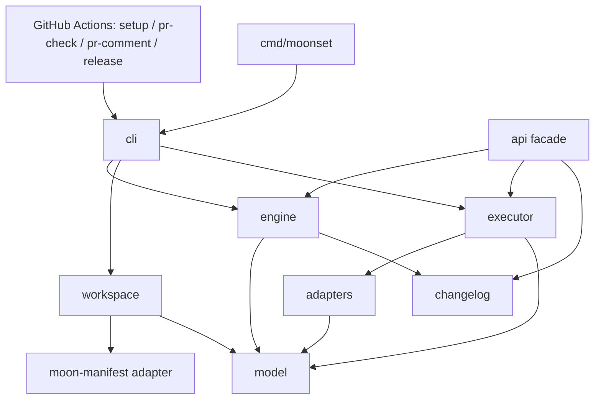

# 系统架构

当前实际依赖主干为 `cmd/moonset → cli → workspace + engine + executor + changelog + adapters → model`，其中 `model`、`engine`、`changelog` 为纯计算核心（同时通过 `native` 与 `wasm-gc` 双目标验证）；`workspace`、`executor`、`adapters`、`cli` 使用 `core/async` 执行宿主机 I/O；`api` 与根包为对外 facade。以下图与目录树反映当前代码架构及自动化编排边界。

## 1. 分层



## 2. 目录与包边界

```text
moonset/
  cmd/moonset/                 # CLI 二进制入口、退出码和顶层错误
  model/                       # 公共领域类型与序列化 schema（跨目标纯库）
  engine/                      # 解析、校验、纯 release planner、状态/Markdown 渲染（跨目标纯库）
  changelog/                   # 内置 changelog 生成器与 registry（跨目标纯库）
  workspace/                   # release domain 发现、Git 快照与清单/依赖解析
  adapters/                    # Capability 契约、PublisherRegistry 与受限 JSONL 插件运行器
  executor/                    # ExecutionHost、原子 journal、staging、pack、publish、tag、doctor
  api/                         # 稳定编程 API facade
  cli/                         # 参数解析、TUI、人类/JSON/Markdown 输出渲染
  setup/                       # GitHub Action：下载并校验预编译 CLI
  pr-check/                    # GitHub Action Job 1：只读执行 status 计算评论与状态
  pr-comment/                  # GitHub Action Job 2：不拉代码幂等创建/更新 PR 评论
  action.yml                   # 根 GitHub Action：version-pr 与 publish 编排
```

`model`、`engine`、`changelog`、`api` 是面向外部消费的公共包，同时保持纯计算层的跨目标可编译性；宿主能力集中在 `workspace`、`executor`、`adapters` 与 `cli`。所有跨包公共接口以各包生成的 `pkg.generated.mbti` 为准。

## 3. 运行时边界

- 目标为 `native`；文件、进程、Git、网络都是宿主能力。
- 纯 planner、SemVer、front matter 和 changelog line 生成保持同步函数，便于快照测试。
- async 入口调用 `moonbitlang/core/async`，文件用 `core/async/fs`，结构化子进程用 `core/async/process` 或 `core/async/shell`。
- `core/async/shell.Cmd` 的程序名和参数分离，禁止把用户输入拼接到 `sh -c`/`cmd /c` 字符串。
- 适配器返回结构化结果；CLI 最后才把结果渲染成人类文本。

## 4. workspace 发现

1. 先解析 moonset 配置控制的 release domain，再由所选 adapter 解析各自 workspace；最近的 `moon.mod` 不能遮蔽外层混合配置。没有配置时，仅对单生态初始化使用原发现行为。
2. MoonBit adapter 读取 `moon.work` members 或单个 `moon.mod`；JS adapter 按 npm/pnpm 原生规则发现已声明成员，不默认接管所有 `package.json`。
3. 清单查询/编辑由 adapter 负责。`moon-manifest` 是 MoonBit adapter 的候选，字段覆盖需经探针验证；它不负责 JS/Cargo 清单。每个版本字段、锁文件和 changeset 目录只有一个写入者。
4. 以 UnitId 构建图，保留原生依赖协议；build bridge 和版本组由显式配置加入，不根据目录邻近推断。构建顺序与 registry 发布顺序独立计算。
5. 生成 `WorkspaceSnapshot`，包含多个 EcosystemWorkspace、ReleaseUnit、字段所有权和能力列表；planner 不再读文件。具体边界见 [混合 workspace 设计](mixed-workspaces.md)。

## 5. 规划与执行

```text
inspect (read only)
  -> validate config/changesets/workspace
  -> build immutable ReleasePlan
  -> render plan and ask confirmation
  -> verify fingerprints
  -> apply FileEdits atomically
  -> consume changesets and write pre state
  -> publish/tag through explicit adapters
```

`version` 在 `apply` 前必须完成全部解析和校验。文件编辑按路径排序；每个目标先检查 beforeHash，再写临时文件、flush、rename。Git commit/tag/push 和 registry publish 不属于文件原子事务，必须有阶段记录和恢复指令。

混合版本写入先在 staging 中生成清单和锁文件 diff，经验证后纳入同一个本地 journal。单文件原子替换不等于多文件事务；崩溃需要检测并恢复。多平台构建和发布使用 version 后持久化的 intent 与 release commit，发布器按单元及目标路由；禁止把所有单元都送给 `moon publish`。

## 6. 依赖策略

- 直接依赖已发布且 API 稳定的 `unmbt/moon-manifest`；在该包完成 `core/async` 迁移和版本发布前，moonset 可以暂时 vendored adapter，但不得复制 parser 逻辑两份。
- 使用 `moon-bump` 中已验证过的 SemVer、Git 和配置合并思路；优先提取小型公共包或重新实现纯算法，避免依赖其 CLI 内部包。
- `native-toolchain` 只用于 `doctor`/构建诊断和需要显式编译器发现的扩展，不进入 version/publish 主流程。
- Changesets 仓库是行为参考；其 Node.js 动态加载、npm package JSON 语义和 registry 行为不直接作为 MoonBit 契约。

## 7. 一致性与恢复

`ReleasePlan` 记录 workspace/config/changesets fingerprint。执行期间发现文件变化则停止并返回 `stale_plan`。写文件失败时保留临时目录和恢复提示；Git 或 registry 部分失败时返回每个步骤状态，不自动猜测补偿动作。

## 8. 自动化层

GitHub Actions（`setup`、`pr-check`、`pr-comment` 与根发布 Action）仅作为薄编排壳层，不在 YAML/shell/JS 中重复实现 workspace 发现、changeset 解析、版本计算或 Markdown 渲染逻辑：

1. 业务判断与评论 Markdown/JSON 生成全部收口在 `engine` 纯函数与 `moonset` CLI。
2. `pr-check` 在只读权限下调用可信预编译 CLI 产出 `comment`、`state`、`exit-code` 与 `should-comment`。
3. `pr-comment` 在无代码 checkout 权限的独立 Job 中仅通过 GitHub REST API（`gh api`）完成评论创建/更新、标签同步与门禁退出。
