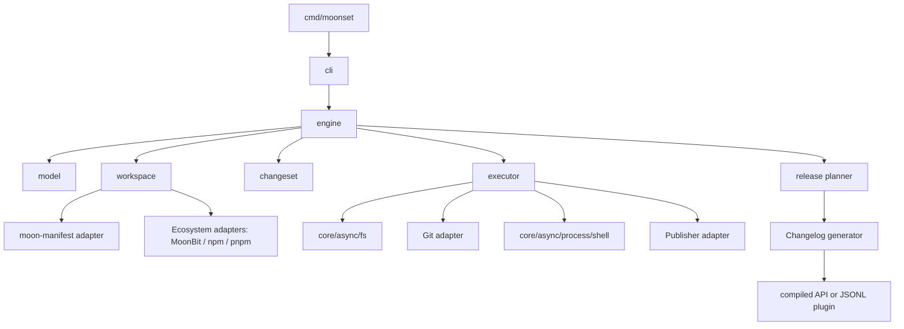

# 系统架构

Phase 1 的实际依赖为 `cmd/moonset → cli → workspace + engine → model`；workspace 使用 manifest/core/async，engine 只包含纯解析、验证、版本规则和规划，不依赖 workspace 或 async。根包是便捷 facade。以下图和 internal 布局描述后续完整架构，executor、publisher、generator 尚未实现。

## 1. 分层



## 2. 目录与包边界

```text
moonset/
  cmd/moonset/                 # 仅负责入口、退出码和顶层错误
  model/                       # 公共领域类型与序列化 schema
  engine/                      # discover/read/build/apply 的公共 facade
  internal/workspace/          # release domain、workspace 所有权与统一依赖图
  internal/ecosystem/          # MoonBit / npm / pnpm 发现、编辑与锁文件适配
  internal/changeset/          # front matter、摘要和 pre 状态
  internal/config/             # 默认值、解析、合并、校验
  internal/planner/            # 纯 release plan 算法
  internal/changelog/          # 内置生成器、模板和格式化
  internal/git/                # Git 命令和快照适配器
  internal/publisher/          # Mooncakes 与外部 publisher
  internal/cli/                # 参数、交互和人类输出
  internal/atomic/              # beforeHash、临时文件、回滚
```

`model` 和 `engine` 是有意公开的包；`internal/*` 不暴露公共具体类型。所有跨包类型由拥有它的 facade 定义，避免通过 `pub using` 暴露 internal 类型造成方法解析和 `.mbti` 不稳定。

## 3. 运行时边界

- 目标为 `native`；文件、进程、Git、网络都是宿主能力。
- 纯 planner、SemVer、front matter 和 changelog line 生成保持同步函数，便于快照测试。
- async 入口调用 `moonbitlang/core/async`，文件用 `core/async/fs`，结构化子进程用 `core/async/process` 或 `core/async/shell`。
- `core/async/shell.Cmd` 的程序名和参数分离，禁止把用户输入拼接到 `sh -c`/`cmd /c` 字符串。
- 适配器返回结构化结果；CLI 最后才把结果渲染成人类文本。

## 4. workspace 发现

1. 先解析 moonset 配置控制的 release domain，再由所选 adapter 解析各自 workspace；最近的 `moon.mod` 不能遮蔽外层混合配置。没有配置时，仅对单生态初始化使用原发现行为。
2. MoonBit adapter 读取 `moon.work` members 或单个 `moon.mod`；JS adapter 按 npm/pnpm 原生规则发现已声明成员，不默认接管所有 `package.json`。
3. 清单查询/编辑由 adapter 负责。`moon-manifest` 是 MoonBit adapter 的候选，字段覆盖需经探针验证；它不负责 JS/Cargo 清单。每个版本字段、锁文件和 changeset 目录只有一个写入者。
4. 以 UnitId 构建图，保留原生依赖协议；build bridge 和版本组由显式配置加入，不根据目录邻近推断。构建顺序与 registry 发布顺序独立计算。
5. 生成 `WorkspaceSnapshot`，包含多个 EcosystemWorkspace、ReleaseUnit、字段所有权和能力列表；planner 不再读文件。具体边界见 [混合 workspace 设计](mixed-workspaces.md)。

## 5. 规划与执行

```text
inspect (read only)
  -> validate config/changesets/workspace
  -> build immutable ReleasePlan
  -> render plan and ask confirmation
  -> verify fingerprints
  -> apply FileEdits atomically
  -> consume changesets and write pre state
  -> publish/tag through explicit adapters
```

`version` 在 `apply` 前必须完成全部解析和校验。文件编辑按路径排序；每个目标先检查 beforeHash，再写临时文件、flush、rename。Git commit/tag/push 和 registry publish 不属于文件原子事务，必须有阶段记录和恢复指令。

混合版本写入先在 staging 中生成清单和锁文件 diff，经验证后纳入同一个本地 journal。单文件原子替换不等于多文件事务；崩溃需要检测并恢复。多平台构建和发布使用 version 后持久化的 intent 与 release commit，发布器按单元及目标路由；禁止把所有单元都送给 `moon publish`。

## 6. 依赖策略

- 直接依赖已发布且 API 稳定的 `unmbt/moon-manifest`；在该包完成 `core/async` 迁移和版本发布前，moonset 可以暂时 vendored adapter，但不得复制 parser 逻辑两份。
- 使用 `moon-bump` 中已验证过的 SemVer、Git 和配置合并思路；优先提取小型公共包或重新实现纯算法，避免依赖其 CLI 内部包。
- `native-toolchain` 只用于 `doctor`/构建诊断和需要显式编译器发现的扩展，不进入 version/publish 主流程。
- Changesets 仓库是行为参考；其 Node.js 动态加载、npm package JSON 语义和 registry 行为不直接作为 MoonBit 契约。

## 7. 一致性与恢复

`ReleasePlan` 记录 workspace/config/changesets fingerprint。执行期间发现文件变化则停止并返回 `stale_plan`。写文件失败时保留临时目录和恢复提示；Git 或 registry 部分失败时返回每个步骤状态，不自动猜测补偿动作。
